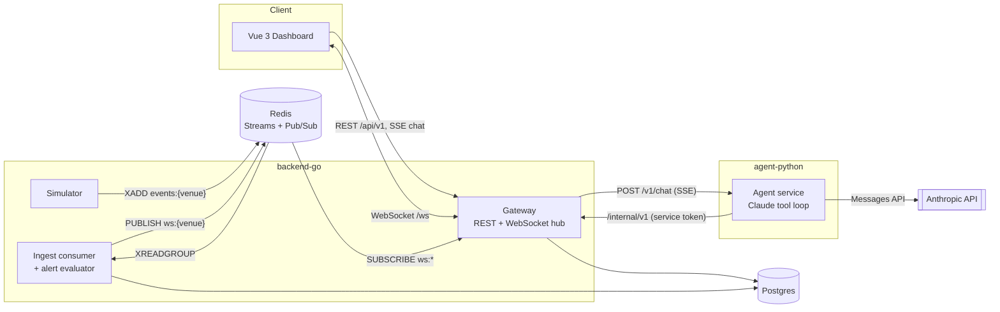
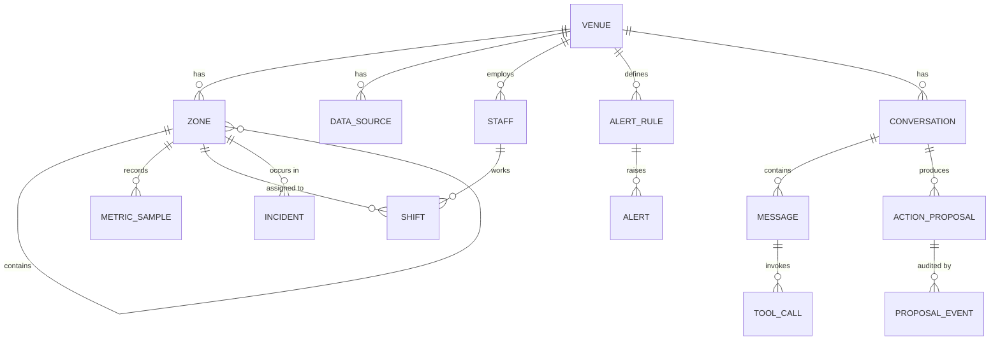
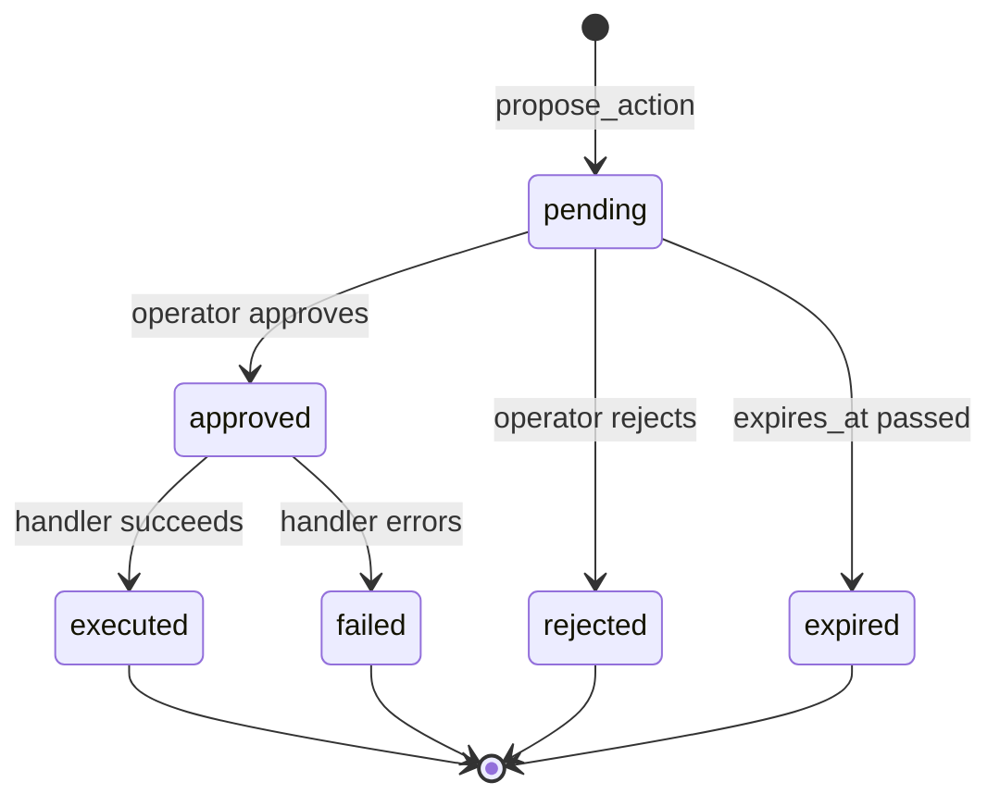
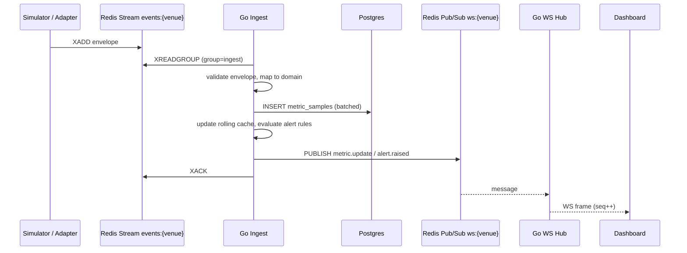
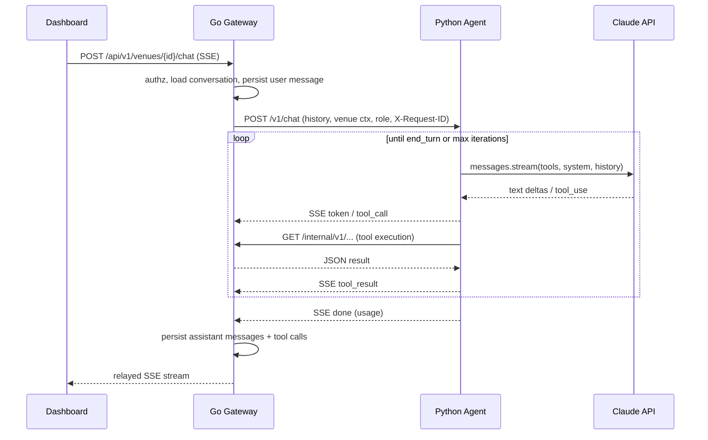
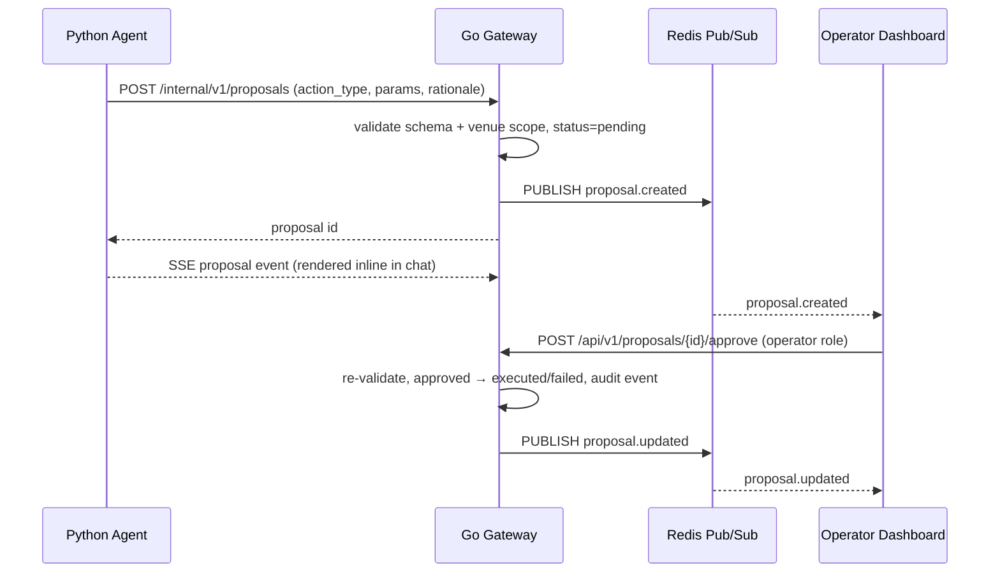

# VenuePulse AI — System Architecture

Status: **Draft v0.1** (pre-implementation). This document is the source of truth for service boundaries, contracts, and repository layout. Significant deviations should be recorded as ADRs in `docs/adr/`.

---

## 1. Overview

VenuePulse AI is an operational copilot for venues of any type (stadiums, arenas, convention centers, restaurants, campuses). It gives operators:

1. **Live situational awareness:** occupancy, queue lengths, throughput, incidents, and staffing per zone, streamed to a dashboard in real time.
2. **Natural-language Q&A over live state:** "Which entrances are backing up?" or "Who's on shift near Section 112?"
3. **Alerting:** rule-based alerts on thresholds and rates of change, with optional AI explanations.
4. **Proposed actions:** the copilot can *propose* operational actions such as dispatching staff, opening a lane or escalating an incident. A human operator approves or rejects each one.

### Goals (v1)
- Domain-neutral model built on venues, zones, metrics, staff, incidents and actions.
- Sub-second fan-out of live updates to connected dashboards.
- A copilot grounded in live data via tool calls, with every tool call audited.
- Runs fully locally with a built-in simulator. No external integrations are required.

### Non-goals (v1)
- Autonomous action execution. Every write the AI initiates goes through human approval.
- Real third-party integrations (POS, ticketing, IoT). These come later behind the ingest adapter interface.
- Multi-region deployment or horizontal sharding.

### Architectural invariants
These are load-bearing. Breaking them requires an ADR.

1. **The Go backend is the sole owner of domain state.** Only Go writes to Postgres.
2. **The Python agent has no database credentials.** It reads and writes state only through Go's internal API.
3. **The AI never executes actions.** It creates `ActionProposal`s. Go executes a proposal only after an authorized human approves it.
4. **Contracts live in `api/`** (OpenAPI and WebSocket JSON Schemas). Client types are generated, not handwritten.

---

## 2. System Context



The gateway, the ingest consumer and the simulator are separate binaries built from one Go module. The gateway and ingest consumer can run in one process during local dev.

---

## 3. Components

### 3.1 Go backend (`backend-go/`)

| Responsibility | Notes |
|---|---|
| **API gateway** | Public REST API under `/api/v1`, authenticated with JWT. Internal API under `/internal/v1`, authenticated with a service token and bound to the internal network only. |
| **Auth & RBAC** | JWT access tokens. Roles: `viewer` (read), `operator` (approve/reject proposals, manage incidents), `admin` (venue config, alert rules, users). |
| **WebSocket hub** | One connection per browser tab, with per-venue subscriptions. Subscribes to Redis pub/sub `ws:{venue_id}` and fans out to local clients. Stateless across instances because Redis does the cross-instance fan-out. |
| **Ingest consumer** | Reads Redis Streams `events:{venue_id}` through consumer group `ingest`. Validates the envelope, persists `MetricSample`s and incident events, updates the rolling metric cache in Redis, evaluates alert rules, and publishes WS messages. |
| **Alert evaluator** | Evaluates threshold and rate-of-change rules on each ingested sample. Deduplicates and auto-resolves alerts. Can optionally request an AI explanation, which runs async. |
| **Proposal executor** | Moves `ActionProposal`s through their state machine (§4.2). Executes approved actions through action handlers, one per action type, and records an audit trail. |
| **Chat proxy** | Authenticates the user, loads the conversation, forwards it to the agent, relays the agent's SSE stream to the browser, and persists the messages and tool calls that result. |
| **Simulator** (`cmd/simulator`) | Generates realistic event streams from scenario files: arrivals curves, queue build-up, incidents. It publishes the same envelope real adapters will use, so the ingest path does not change when integrations arrive. |

**Stack:** Go 1.23+, `net/http` with `chi` router, `coder/websocket`, `pgx/v5` with `sqlc`, `goose` migrations, `redis/go-redis/v9`, `log/slog` (JSON handler).

### 3.2 Python agent (`agent-python/`)

A stateless FastAPI service that runs the Claude tool-calling loop.

- Receives a chat request from Go: conversation history, venue context, user role and request ID.
- Calls the Anthropic Messages API with streaming and the tool definitions (§7).
- Executes tool calls by calling Go's `/internal/v1` read endpoints. `propose_action` POSTs a pending proposal to Go.
- Streams `token`, `tool_call`, `tool_result`, `proposal`, `done` and `error` events back to Go as SSE.
- Does **not** persist anything. Go persists conversations, messages and tool calls from the stream.
- Holds the Anthropic API key. No other service does.

**Model:** configurable through `VP_AGENT_MODEL`. The default is `claude-sonnet-5-5` for interactive latency. `claude-opus-5-5` is recommended for deep analysis such as post-event summaries and multi-zone root-cause questions.

**Stack:** Python 3.12+, `uv`, FastAPI with `uvicorn`, `anthropic` SDK, `httpx` (async gateway client), `pydantic` v2 and `pydantic-settings`, `structlog`.

### 3.3 Vue frontend (`frontend-vue/`)

**Stack:** Vue 3 (Composition API, `<script setup>`), TypeScript, Vite, Pinia, Vue Router, and an API client generated from `api/openapi.yaml`.

| View | Purpose |
|---|---|
| Venue overview | Zone grid or map colored by occupancy and queue state, plus KPIs and active alerts. |
| Zone detail | Metric time-series, staff on shift, incidents. |
| Incidents & alerts | List and detail views, plus acknowledge and resolve actions. |
| Copilot panel | Chat UI that renders streamed tokens. Tool calls appear as collapsible "what I looked at" chips. Proposals appear as inline approval cards. |
| Proposals queue | Pending, approved and executed proposals. Approve and reject actions are visible to operators only. |
| Admin | Venue and zone config, alert rules, simulator scenario control (dev only). |

The live state lives in Pinia stores that a single `useVenueSocket` composable feeds. It handles reconnects with backoff, venue subscription, and gap detection and resync using `seq` (§6.2).

---

## 4. Domain Model

### 4.1 Entities



| Entity | Key fields |
|---|---|
| `Venue` | `id`, `name`, `kind` (free text, e.g. `stadium`, `restaurant`), `timezone`, `capacity` |
| `Zone` | `id`, `venue_id`, `parent_zone_id?`, `name`, `kind` (`entrance`, `seating`, `concourse`, `concession`, `room`…), `capacity`, `geometry?` |
| `DataSource` | `id`, `venue_id`, `kind` (`simulator`, `sensor`, `pos`, `ticketing`), `config jsonb`, `status` |
| `MetricSample` | `venue_id`, `zone_id`, `metric` (`occupancy`, `queue_length`, `wait_time_s`, `throughput_per_min`…), `value`, `ts`, `source_id`. Stored in a **range-partitioned table by day**. |
| `Staff` / `Shift` | Staff `id`, `name`, `role`, `skills[]`. Shift `staff_id`, `zone_id?`, `starts_at`, `ends_at`, `status` |
| `Incident` | `id`, `zone_id`, `severity` (`low`…`critical`), `category`, `status` (`open`, `acknowledged`, `resolved`), `description`, timestamps |
| `AlertRule` | `id`, `venue_id`, `scope` (zone or zone kind), `metric`, `condition` (`gt`, `lt`, `rate_gt`), `threshold`, `window_s`, `cooldown_s`, `severity` |
| `Alert` | `id`, `rule_id`, `zone_id`, `status` (`firing`, `acknowledged`, `resolved`), `value`, `fired_at`, `resolved_at`, `ai_explanation?` |
| `Conversation` / `Message` | Conversation `id`, `venue_id`, `user_id`. Message `role`, `content jsonb` (Anthropic content blocks), `model`, `usage jsonb` |
| `ToolCall` | `id`, `message_id`, `tool_name`, `input jsonb`, `output jsonb`, `duration_ms`, `error?` |
| `ActionProposal` | `id`, `venue_id`, `conversation_id?`, `action_type`, `params jsonb`, `rationale`, `status`, `proposed_by` (`agent`/user id), `decided_by?`, `expires_at` |
| `ProposalEvent` | Append-only audit: `proposal_id`, `from_status`, `to_status`, `actor`, `ts`, `detail jsonb` |

### 4.2 ActionProposal state machine



v1 action types are a closed set registered in Go: `dispatch_staff`, `reassign_shift`, `open_incident`, `escalate_incident`, `broadcast_notice`, `adjust_zone_capacity`. Each has a parameter schema that is validated both when proposed and when executed. Agent-proposed `params` are never trusted without that validation.

---

## 5. Key Flows

### 5.1 Ingest → live dashboard



- Delivery is at-least-once. Inserts are idempotent through a `(source_id, event_id)` unique key.
- Ingest batches writes, flushing every 250 ms or every 500 rows. WS messages for a zone are coalesced to at most 4 Hz.
- Entries that fail validation repeatedly go to the dead-letter stream `events:dlq` and are logged with the full envelope.

### 5.2 Copilot chat



Chat uses SSE rather than the WebSocket because it is request-scoped, easy to cancel, and proxies cleanly. If the browser disconnects, Go cancels the request context, the cancellation reaches the agent, and the agent aborts the Anthropic stream.

### 5.3 Action proposal and approval



### 5.4 Alert evaluation and AI explanation
1. The ingest consumer evaluates rules matching the sample's zone and metric.
2. When a rule's condition holds for `window_s` and no alert is in cooldown, ingest creates an `Alert` and publishes `alert.raised`.
3. If AI explanations are enabled for the rule's severity, Go enqueues an async job. The job calls the agent's `POST /v1/explain`, which runs a one-shot tool loop over the same read tools. Go stores the result on `alert.ai_explanation` and publishes `alert.updated`. A failure here never blocks or fails alerting.

---

## 6. API Contracts

All contracts live in `api/` and are versioned with the code.

### 6.1 REST (`api/openapi.yaml`)

- **Public** (`/api/v1`, JWT): venues, zones, metrics snapshots and history, incidents, alerts, alert rules, staff and shifts, proposals (list, approve, reject), conversations, and chat (SSE).
- **Internal** (`/internal/v1`, `Authorization: Bearer <service token>`): read-optimized endpoints for agent tools, plus `POST /proposals`. These endpoints are never exposed through the public ingress.
- **Errors** follow RFC 7807 `application/problem+json`: `{type, title, status, detail, instance, request_id}`.
- **Pagination** is cursor-based (`?cursor=&limit=`).
- **Codegen:** the TS client in `frontend-vue/src/api/` and the Go server types are generated from the spec. The Python gateway client uses pydantic models generated from the spec.

### 6.2 WebSocket (`/ws`, schemas in `api/ws/`)

Auth: a short-lived WS ticket from `POST /api/v1/ws-ticket`, passed as a query param. Origin checked against an allowlist.

Envelope (both directions):

```json
{ "type": "metric.update", "venue_id": "ven_123", "seq": 48213, "ts": "2026-10-11T18:04:05.123Z", "payload": {} }
```

| Direction | Types |
|---|---|
| Client → server | `subscribe`, `unsubscribe`, `ping` |
| Server → client | `metric.update`, `alert.raised`, `alert.updated`, `incident.created`, `incident.updated`, `proposal.created`, `proposal.updated`, `shift.updated`, `pong`, `error` |

`seq` increases monotonically per venue and is assigned by ingest using Redis `INCR`. When a client sees a gap, it refetches `GET /api/v1/venues/{id}/snapshot`, which returns state plus the current `seq`, and resumes from there.

### 6.3 Agent API (internal, served by `agent-python`)

`POST /v1/chat`, request:

```json
{
  "conversation_id": "conv_...",
  "venue": { "id": "ven_123", "name": "...", "timezone": "...", "kind": "stadium" },
  "user": { "id": "usr_...", "role": "operator" },
  "messages": [ /* Anthropic-format content blocks */ ]
}
```

Response: `text/event-stream` with these events:

| Event | Data |
|---|---|
| `token` | `{ "text": "..." }` |
| `tool_call` | `{ "id", "name", "input" }` |
| `tool_result` | `{ "id", "output", "is_error", "duration_ms" }` |
| `proposal` | `{ "proposal_id", "action_type", "summary" }` |
| `message` | The final assistant content blocks, which Go persists |
| `done` | `{ "stop_reason", "usage" }` |
| `error` | `{ "code", "message", "retryable" }` |

`POST /v1/explain` has the same shape and takes `{alert_id, venue}`.

---

## 7. AI Agent Design

### 7.1 Loop

The loop calls `messages.stream` with the system prompt, the tools and the conversation history.

- On `tool_use`, it executes the tools concurrently with `asyncio.gather`, appends a `tool_result` for each, and loops.
- It stops on `end_turn`, after `VP_AGENT_MAX_ITERATIONS` iterations (default 8), or at the wall-clock budget `VP_AGENT_TIMEOUT_S` (default 60).
- **Tool errors** are returned to the model as `tool_result` with `is_error: true` so it can recover, and they are logged. The loop aborts and emits `error` only on infrastructure failures, such as an unreachable Anthropic API or a repeated gateway outage.

### 7.2 Prompting
- **The system prompt** is static and cached with `cache_control`. It covers the role, the read + propose policy, output style (concise and operational, with zone names and numbers cited) and the rule "never claim an action was taken; propose it."
- **Venue context** varies per request: venue name, kind, local time, zone list summary and user role. It goes in a second system block after the cache breakpoint.
- **Tool definitions** are static, ordered deterministically, and covered by the cache.

### 7.3 Tool catalog (v1)

| Tool | Backed by | Purpose |
|---|---|---|
| `get_venue_overview` | `GET /internal/v1/venues/{id}/overview` | Current KPIs, hottest zones, open alerts and incidents |
| `get_zone_metrics` | `GET /internal/v1/zones/{id}/metrics` | Latest values plus short trend for a zone |
| `query_metric_history` | `GET /internal/v1/metrics/history` | Aggregated time series (zone or kind, metric, window, bucket) |
| `list_incidents` | `GET /internal/v1/venues/{id}/incidents` | Filter by status, severity, zone |
| `list_alerts` | `GET /internal/v1/venues/{id}/alerts` | Firing or recent alerts |
| `get_staff_on_shift` | `GET /internal/v1/venues/{id}/shifts/active` | Who is on shift, where, and their skills |
| `find_zones` | `GET /internal/v1/venues/{id}/zones?q=` | Resolves names like "north gate" to zone IDs |
| `propose_action` | `POST /internal/v1/proposals` | Creates a pending proposal. Its input schema is a discriminated union over action types |

Guardrails:
- Every tool call carries the venue ID **injected by the agent from the request context**, not taken from model input. Go additionally enforces venue scope.
- `propose_action` is offered only when `user.role` is `operator` or above. The model cannot approve anything.
- Tool outputs are trimmed to a token budget, for example by capping rows and pre-aggregating series, before they are returned to the model.

---

## 8. Cross-Cutting Concerns

### 8.1 Structured logging
- **Go:** `log/slog` with the JSON handler. A logger carrying request-scoped attributes travels in `context.Context`.
- **Python:** `structlog` with JSON rendering and `contextvars` binding.
- **Required fields:** `ts`, `level`, `service`, `msg`, `request_id`. Add `trace_id`, `venue_id`, `user_id`, `conversation_id`, `proposal_id` and `tool_name` when known.
- **Correlation:** Go assigns or accepts `X-Request-ID` at the edge and propagates it, along with W3C `traceparent`, to the agent and back on every internal call.
- **Not logged:** JWTs, the service token, the Anthropic key, or full chat content at `info`. Chat content is logged only at `debug` and only in dev.

### 8.2 Error handling
- **Go:** errors are wrapped with `fmt.Errorf("...: %w", err)` at each layer, and sentinel or typed domain errors (`ErrNotFound`, `ErrForbidden`, `ErrInvalidTransition`, `ValidationError`) are classified with `errors.Is` and `errors.As`. A single HTTP error mapper turns them into problem+json, so handlers never write raw error strings. Each error is logged once, at the boundary that handles it.
- **Python:** a typed hierarchy rooted at `AgentError` (`GatewayError`, `ToolInputError`, `ModelError`, `BudgetExceeded`) maps to SSE `error` codes with a `retryable` flag. Anthropic SDK errors are caught and classified: rate limits and overload are retryable, invalid requests are not.
- **Frontend:** API errors are parsed from problem+json into a typed `ApiError`. The global handler shows toasts. Connection-state UI is driven by the socket composable.
- **Retries:** exponential backoff with jitter on idempotent internal calls and on Anthropic `429`/`529`. Non-idempotent POSTs are never retried blindly.

### 8.3 Observability
- Prometheus `/metrics` on every service. Key series: ingest lag (stream pending count), WS connections, chat latency and time to first token, tool latency and error rate, and Anthropic token usage by model.
- OpenTelemetry tracing is designed in but optional in v1.
- `/healthz` (liveness) and `/readyz` (dependencies reachable) on every service.

### 8.4 Security
- JWT access tokens are short-lived. RBAC is enforced in Go middleware and again on proposal transitions.
- Internal API calls use a shared service token (rotatable) and network isolation.
- Only `agent-python` holds the Anthropic API key.
- CORS and WS origin allowlists apply. Request size limits apply, as does per-user rate limiting on chat.
- Prompt-injection posture: tool outputs are data, the agent can only read and propose, and proposals require human approval. These together bound the blast radius.

### 8.5 Configuration
12-factor env vars with prefix `VP_`. Each service ships `.env.example`. Config is loaded once at startup into a typed struct (Go) or `pydantic-settings` model (Python), and the service fails fast if it is invalid.

---

## 9. Repository Structure

```
.
├── api/                          # Contracts (source of truth)
│   ├── openapi.yaml              # Public + internal REST
│   ├── events/                   # Ingest envelope JSON Schema (sources → Redis Streams)
│   └── ws/                       # WebSocket envelope + message JSON Schemas
├── backend-go/
│   ├── cmd/
│   │   ├── gateway/              # REST + WS + chat proxy (+ ingest in dev)
│   │   ├── ingest/               # Standalone ingest consumer
│   │   └── simulator/            # Scenario-driven event generator
│   ├── internal/
│   │   ├── config/               # Typed env config
│   │   ├── logging/              # slog setup, context helpers
│   │   ├── httpapi/              # Router, middleware, handlers, problem+json mapper
│   │   ├── ws/                   # Hub, client conn, subscriptions
│   │   ├── auth/                 # JWT, RBAC, service token, WS tickets
│   │   ├── domain/               # Entities, domain errors, proposal state machine
│   │   ├── store/                # pgx + sqlc generated queries, repositories
│   │   ├── events/               # Envelope types, Redis stream/pubsub clients
│   │   ├── ingest/               # Consumer, batching, adapters interface
│   │   ├── alerts/               # Rule evaluation, explanation jobs
│   │   ├── proposals/            # Service + action handlers registry
│   │   ├── agentclient/          # SSE client to agent-python
│   │   └── simulator/            # Scenario engine
│   ├── migrations/               # goose SQL migrations
│   ├── scenarios/                # Simulator scenario YAML
│   ├── sqlc.yaml
│   └── go.mod
├── agent-python/
│   ├── src/venuepulse_agent/
│   │   ├── main.py               # FastAPI app factory
│   │   ├── config.py             # pydantic-settings
│   │   ├── logging.py            # structlog setup
│   │   ├── errors.py             # AgentError hierarchy
│   │   ├── api/                  # /v1/chat, /v1/explain, health
│   │   ├── agent/                # Loop, streaming, prompts/, budgets
│   │   ├── tools/                # One module per tool: schema + handler
│   │   └── clients/              # Gateway internal API client (httpx)
│   ├── tests/
│   └── pyproject.toml
├── frontend-vue/
│   ├── src/
│   │   ├── api/                  # Generated client + ApiError
│   │   ├── stores/               # Pinia: venue, metrics, alerts, proposals, chat
│   │   ├── composables/          # useVenueSocket, useChatStream
│   │   ├── views/                # Route-level pages
│   │   ├── components/           # UI components (zone grid, chat, proposal card…)
│   │   └── router/
│   ├── package.json
│   └── vite.config.ts
├── deploy/
│   ├── docker-compose.yml        # postgres, redis, gateway, ingest, simulator, agent, frontend
│   └── docker/                   # Per-service Dockerfiles
├── docs/
│   ├── architecture.md
│   └── adr/
├── Makefile                      # Top-level dev / test / lint / generate
└── CLAUDE.md
```

---

## 10. Tooling & Developer Workflow (planned)

None of these exist yet. They are the intended commands.

| Area | Commands |
|---|---|
| Whole stack | `make dev` (docker-compose up), `make test`, `make lint`, `make generate` (OpenAPI → Go/TS/Python types, sqlc) |
| Go | `go test ./...`, single test: `go test ./internal/proposals -run TestApprove`, `golangci-lint run`, `sqlc generate`, `goose -dir migrations up` |
| Python | `uv sync`, `uv run pytest`, single test: `uv run pytest tests/test_loop.py::test_tool_error`, `uv run ruff check`, `uv run mypy src` |
| Vue | `pnpm install`, `pnpm dev`, `pnpm test` (vitest), single test: `pnpm vitest run src/stores/metrics.spec.ts`, `pnpm lint`, `pnpm type-check` (vue-tsc) |
| Simulator | `go run ./cmd/simulator -scenario scenarios/stadium-ingress.yaml -speed 10` |

---

## 11. Testing Strategy

- **Go unit tests:** proposal state machine, alert rule evaluation, envelope validation, problem+json mapping.
- **Go integration tests:** `testcontainers-go` for Postgres and Redis. Covers the ingest path from end to end, idempotency, and WS fan-out across two hub instances.
- **Agent tests:**
  - A fake Anthropic client returns scripted streams, including `tool_use` blocks.
  - The gateway client is mocked with recorded fixtures.
  - Tests assert on emitted SSE events, budget enforcement and error classification.
  - An opt-in live smoke test runs against the real API.
- **Frontend tests:** Vitest for stores and composables, using a fake WS for gap/resync logic. Component tests for the chat and proposal card.
- **End-to-end tests:** docker-compose runs a short simulator scenario. Playwright asserts that the dashboard updates, an alert fires, and a proposal can be approved.
- **Contract tests:** CI fails if generated code drifts from `api/`.

---

## 12. Roadmap

| Milestone | Scope |
|---|---|
| **M1: Live skeleton** | Repo scaffolding, compose, migrations, simulator, ingest, WS hub, venue overview dashboard |
| **M2: Read-only copilot** | Agent service, read tools, chat proxy + persistence, copilot panel |
| **M3: Proposals** | `propose_action`, proposal service and handlers, approval UI, audit trail |
| **M4: Alerting** | Alert rules CRUD, evaluator, alert UI, async AI explanations |
| **M5: First real adapter** | Ingest adapter interface proven with one real source; DLQ tooling |

---

## 13. Open Questions (ADR seeds)

1. **Multi-tenancy:** a single-tenant deployment per customer, or an `org_id` column plus row-level security?
2. **Time-series storage:** native partitioned tables are enough for v1. When do we adopt TimescaleDB, and does it pay off then?
3. **Auth provider:** built-in user store vs. OIDC (Auth0, Keycloak) from the start.
4. **Conversation retention:** how long chat and tool-call audit data are kept, and whether to redact PII.
5. **Action execution side effects:** in v1, handlers only mutate VenuePulse state and emit notifications. Decide how external side effects (paging, radios) integrate later.
